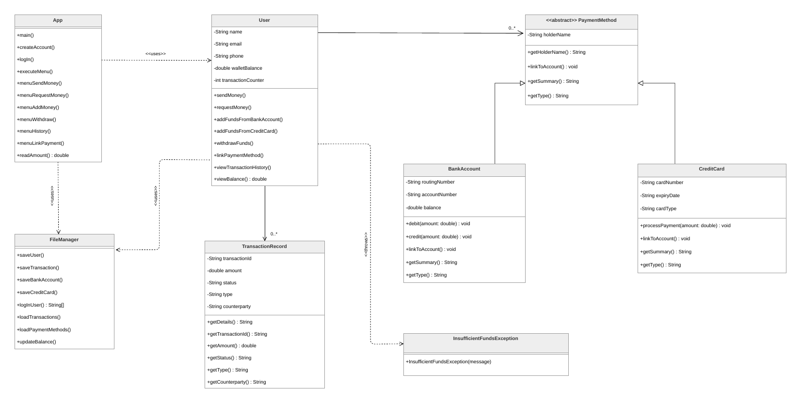

# DigiWallet

A Venmo-style digital wallet in Java with a Swing dialog interface. You can create an account, link a bank account or card, add money, send and request money by email, withdraw, and read your transaction history. Everything is saved to text files, so the balance, history and linked methods are still there the next time you open it.

It was the final project for CS 200 (Programming II) at MassBay Community College. It started as a bank system and drifted toward Venmo along the way.

## What's inside

- **Accounts and login.** Sign up with name, email, phone and password, then log back in later.
- **Payment methods.** `PaymentMethod` is an abstract class, and `BankAccount` and `CreditCard` extend it. The user's list holds both types, and each one reports its own summary and type.
- **Money movement.** Add money from a linked bank account or card, withdraw to a bank account, send money, or request it. A request is logged as `PENDING`. Sending or withdrawing more than the wallet holds, or debiting more than a bank account has, throws a custom `InsufficientFundsException`.
- **Persistence.** `FileManager` reads and writes `users.txt`, `transactions_<email>.txt` and `paymentmethods_<email>.txt` using a `|`-separated format.
- **Input handling.** `readAmount()` calls itself until it gets a valid positive number.



The design work is in the repo too, in `docs/`: [UML class diagram](docs/uml-class-diagram.pdf), [use case diagram](docs/use-case-diagram.pdf), [use cases](docs/use-cases.pdf), [personas](docs/personas.pdf) and a [project summary](docs/project-summary.pdf).

## Run it

Requires JDK 8 or newer.

```bash
git clone https://github.com/victorhubarb/digiwallet.git
cd digiwallet
javac src/digitalwallet/*.java -d out
java -cp out digitalwallet.App
```

The data files are created in the folder you run it from.

## Project structure

```
src/digitalwallet/
├── App.java                        Entry point and every menu dialog
├── User.java                       Balance, transactions, payment methods
├── PaymentMethod.java              Abstract base class
├── BankAccount.java
├── CreditCard.java
├── TransactionRecord.java
├── FileManager.java                All file reading and writing
└── InsufficientFundsException.java
docs/                               UML, use cases, personas, summary
```

## Known gaps

- Passwords are stored in plain text in `users.txt`.
- Send and request only change the sender's side. The recipient's balance and history are not updated.
- Bank balances are simulated: each `BankAccount` gets a random starting amount (not saved between runs), and card payments are not processed, only logged.
- Routing numbers, card numbers and expiry dates are not validated.
- `App.java` mixes UI and flow control, which is the first thing I would split up.

---

Victor Hugo Barbosa · [GitHub](https://github.com/victorhubarb) · [LinkedIn](https://www.linkedin.com/in/victorhbarbosa/)
